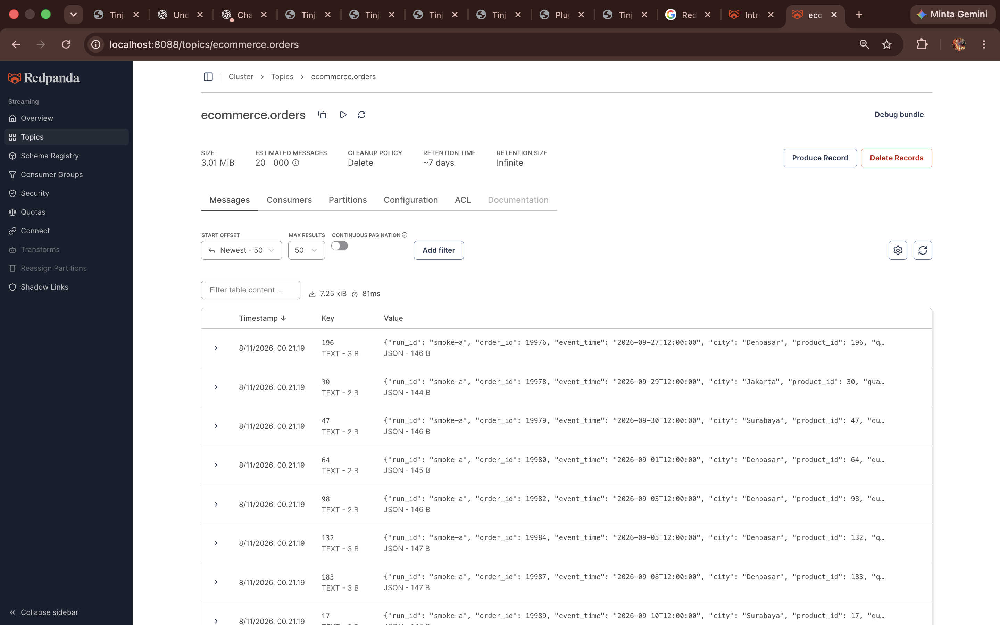
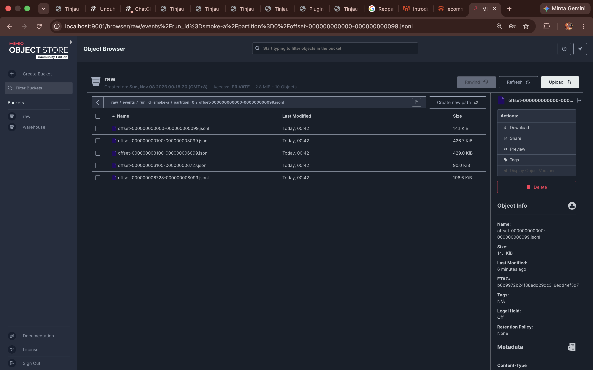
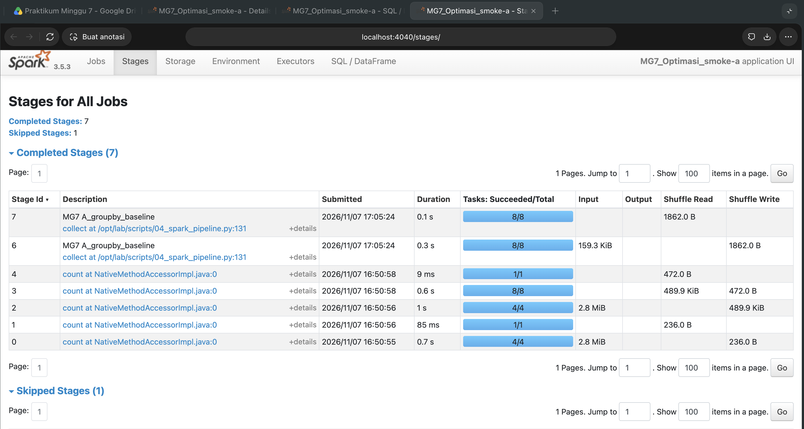
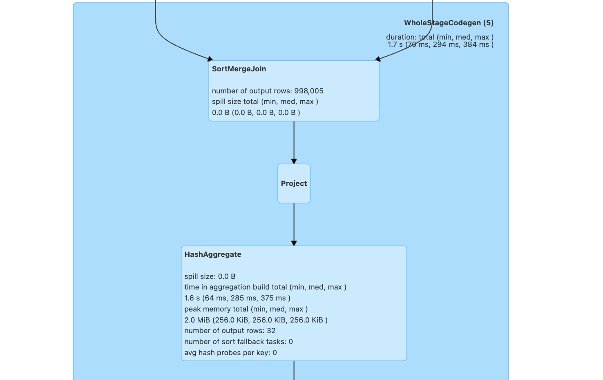
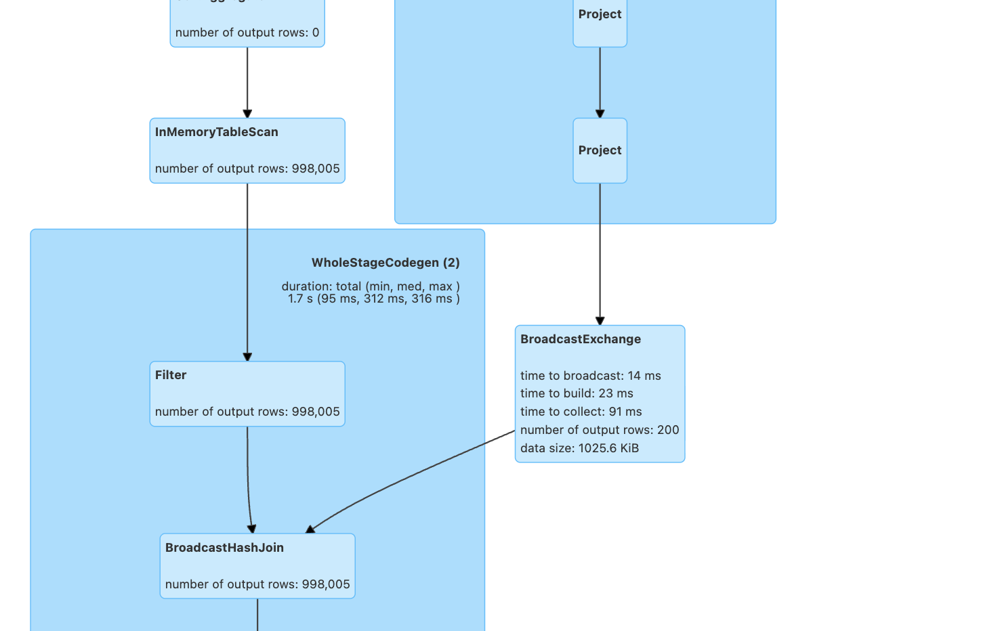
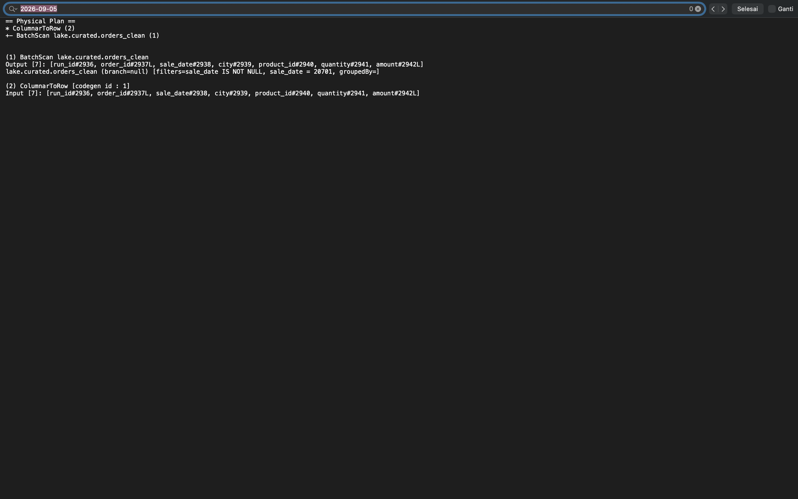
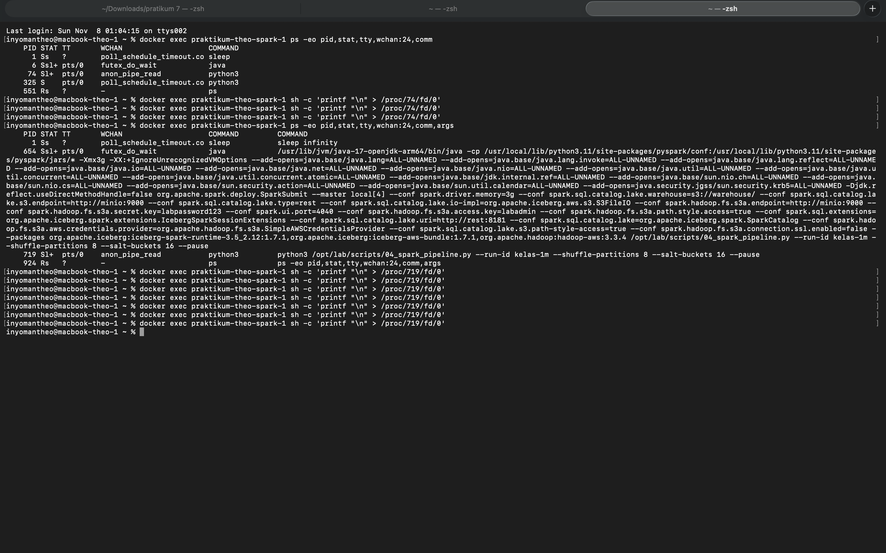
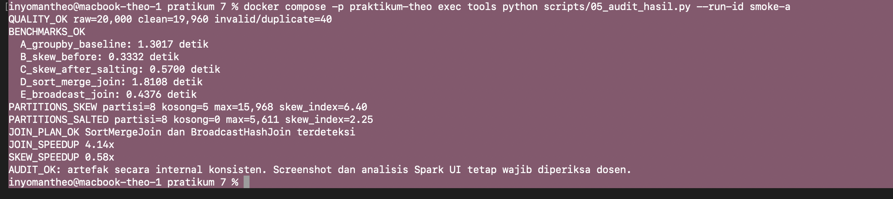
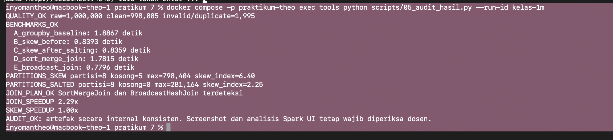

# Laporan Milestone 2a · Komparasi Kinerja PySpark

**Nama:** I Nyoman Theo Ardiles Rada · **NIM:** 42430018  
**Kelompok:** — · **Run ID:** `smoke-a` dan `kelas-1m`  
**Mata kuliah:** Analitik dan Skalabilitas Data · [Repositori Git](https://github.com/theorada/pratikum-analitik-skabilitas-data-theo-ai)

Pada satu juta transaksi sintetis, 998.005 baris lolos pembersihan dan tersimpan di Iceberg. Broadcast join menghasilkan agregat yang sama dengan sort-merge join dalam 0,7796 detik dibandingkan 1,7815 detik. Salting memperbaiki distribusi partisi, dengan selisih waktu agregasi hanya 3,4 ms.

## 1. Lingkungan pengujian

| Komponen | Konfigurasi percobaan |
|---|---|
| Perangkat | Mac dengan Apple M1, CPU 8 inti, RAM fisik 8 GB |
| Lingkungan | Docker 29.8.1, proyek Compose `praktikum-theo`, Java 17 ARM64 |
| Spark | PySpark 3.5.3, `local[4]`, memori driver 3 GB |
| Input | 20.000 dan 1.000.000 event, masing-masing dengan run ID tersendiri |
| Partisi | 3 partisi Kafka, faktor replikasi 1, 8 partisi shuffle Spark |
| Optimasi | 16 salt bucket, AQE nonaktif, ambang auto-broadcast −1. Percobaan E memanggil broadcast secara eksplisit. |

## 2. Topologi dan aliran data

```text
Producer → Redpanda (ecommerce.orders) → Consumer → MinIO raw (JSONL)
                                                      ↓
                                              Spark local[4]
                                                      ↓
                              Iceberg REST Catalog + MinIO warehouse
                                    orders_clean   sales_summary
```

Producer mengirim satu event per transaksi. Consumer mengelompokkan pesan menurut partisi dan menyimpan batch dengan rentang offset pada nama objek. Consumer melakukan commit offset sesudah unggahan berhasil. Jika terjadi pengulangan batch, Spark dapat mengenali transaksi yang sama melalui pasangan run ID dan order ID.

### Urutan menjalankan praktikum

Untuk instalasi baru, buat file `.env` di samping `docker-compose.yml` dan isi satu baris `LAB_MINIO_PASSWORD=sandi-pilihanmu`. Ganti contoh tersebut dengan sandi lokal minimal delapan karakter. Untuk volume MinIO yang sudah ada, gunakan sandi praktikum yang sama.

Jalankan dari direktori yang memuat [docker-compose.yml](docker-compose.yml). Pada Mac ini API MinIO memakai port host 19000 dan Console memakai 9001. Untuk lingkungan baru, jalankan persiapan berikut sekali.

```sh
docker compose -p praktikum-theo up -d --build
docker compose -p praktikum-theo ps
docker compose -p praktikum-theo exec tools python scripts/00_setup.py
docker compose -p praktikum-theo exec redpanda rpk topic create ecommerce.orders -p 3 -r 1
docker compose -p praktikum-theo exec redpanda rpk topic describe ecommerce.orders
```

Untuk mereproduksi dua ukuran uji, jalankan blok berikut dengan satu pasangan parameter per pengujian. Contoh ini memakai ID baru agar data mentah dan berkas benchmark terdahulu tetap dapat dibedakan. Penulisan tabel curated memakai `createOrReplace`, sehingga isi tabel aktif mengikuti run terakhir. Simpan bukti snapshot sebelum berpindah run.

```sh
run_id=smoke-b
rows=20000
# Untuk pengujian berikutnya: run_id=kelas-1m-v2 dan rows=1000000
docker compose -p praktikum-theo exec tools python scripts/01_producer.py --rows "$rows" --run-id "$run_id"
docker compose -p praktikum-theo exec tools python scripts/02_consumer_raw_minio.py --expected "$rows" --run-id "$run_id"
docker compose -p praktikum-theo exec tools python scripts/03_inspect_raw.py --run-id "$run_id"
docker compose -p praktikum-theo exec spark bash scripts/run_spark.sh --run-id "$run_id" --shuffle-partitions 8 --salt-buckets 16 --pause
docker compose -p praktikum-theo exec tools python scripts/05_audit_hasil.py --run-id "$run_id"
```

Selama jeda Spark, amati Jobs, SQL/DataFrame dan Stages di localhost:4040. Console Redpanda ada di localhost:8088. Periksa bucket raw dan warehouse di localhost:9001. Setelah audit dan pengambilan bukti selesai, hentikan layanan dengan `docker compose -p praktikum-theo stop`.



*Topic ecommerce.orders dan contoh payload di Redpanda Console.*



*Objek JSONL pada partisi raw di MinIO.*

## 3. Validasi dan kualitas data

| Run | Raw | Bersih | Invalid atau duplikat | Baris Iceberg |
|---|---:|---:|---:|---:|
| smoke-a | 20.000 | 19.960 | 40 | 19.960 |
| kelas-1m | 1.000.000 | 998.005 | 1.995 | 998.005 |

Spark menyeragamkan penulisan kota dan mengubah waktu event menjadi tanggal penjualan. Aturan validasi mensyaratkan order ID, kota terisi, tanggal valid, amount nonnegatif, quantity positif dan product ID antara 1–200 agar transaksi dapat dihitung dan dipasangkan dengan dimensi produk. Deduplikasi memakai run ID dan order ID. Selisih raw dan bersih adalah jumlah gabungan baris invalid atau duplikat. Pada kedua run, jumlah di orders_clean sama dengan jumlah bersih.

## 4. Analisis execution plan dan shuffle

Pada eksperimen A, Spark menghitung jumlah pesanan dan total penjualan per kota. HashAggregate merangkum 998.005 baris bersih menjadi 24 hasil parsial. Exchange mendistribusikannya agar hasil untuk kota yang sama dapat dijumlahkan menjadi tiga baris akhir. Pada kelas-1m, Stage 7 menulis 1.887 byte dan Stage 8 membacanya. Keduanya menyelesaikan 8/8 task. Pada smoke-a, Stage 6 dan 7 mempertukarkan 1.862 byte. Ukuran shuffle A tetap kecil karena agregasi parsial terjadi sebelum pertukaran.



*Spark UI smoke-a memperlihatkan shuffle write dan shuffle read pada dua stage agregasi.*

## 5. Penanganan data skew

Repartisi berdasarkan kota mengumpulkan sekitar 80% data pada satu partisi. Salting membentuk subkelompok dengan hash order ID modulo 16. Spark menghitung agregat per kota dan salt, lalu menjumlahkan kembali hasilnya per kota. VALIDASI_SALTING_OK memastikan jumlah pesanan dan gross sales per kota identik pada eksperimen A, B, dan C.

| ID partisi | smoke-a sebelum | smoke-a sesudah | kelas-1m sebelum | kelas-1m sesudah |
|---:|---:|---:|---:|---:|
| 0 | 0 | 2562 | 0 | 131033 |
| 1 | 0 | 1795 | 0 | 92957 |
| 2 | 1996 | 5611 | 99801 | 281164 |
| 3 | 15968 | 4525 | 798404 | 218970 |
| 4 | 0 | 245 | 0 | 12622 |
| 5 | 0 | 1232 | 0 | 62440 |
| 6 | 1996 | 1396 | 99800 | 68203 |
| 7 | 0 | 2594 | 0 | 130616 |

Indeks skew (maksimum dibagi rata-rata delapan partisi) turun dari 6,40 menjadi 2,25 pada kedua skala. Di Stage 18 kelas-1m sebelum salting, task 572 membaca 4,6 MiB dan memerlukan 0,4 detik, sedangkan lima task mencatat nol record input. Salting mengisi semua partisi, tetapi penambahan kunci dan agregasi kedua juga membutuhkan waktu. Pada 20 ribu event, C lebih lambat daripada B. Pada satu juta event, selisih waktunya terlalu kecil untuk menyimpulkan percepatan yang konsisten.

## 6. Broadcast join

D mengatur ulang dan mengurutkan data menurut product ID sebelum SortMergeJoin. E menyiarkan tabel produk yang hanya berisi 200 baris lewat BroadcastExchange, sehingga transaksi dapat dicocokkan pada partisinya masing-masing. Agregasi per kategori setelah join masih dapat memicu shuffle. Kedua strategi menghasilkan empat kategori, dengan jumlah pesanan dan gross sales identik. Broadcast memerlukan ruang memori untuk salinan dimensi pada executor serta pengumpulan dimensi di driver. Dimensi yang jauh lebih besar perlu dinilai ulang.



*Run kelas-1m. SortMergeJoin menghasilkan 998.005 baris sebelum agregasi kategori.*



*Run kelas-1m. BroadcastExchange menyiarkan 200 baris menuju BroadcastHashJoin.*

## 7. Partition pruning dan Iceberg

orders_clean menyimpan detail bersih menurut sale_date. sales_summary merangkum jumlah pesanan dan gross sales menurut tanggal, kota dan kategori. Untuk menguji pemilihan partisi, Spark menghitung baris untuk satu tanggal.

```sql
SELECT COUNT(*) FROM lake.curated.orders_clean
WHERE sale_date = DATE '2026-09-05';
```

Hasilnya 666 baris pada smoke-a dan 33.268 pada kelas-1m. Kedua physical plan memperlihatkan BatchScan dengan filter sale_date = 20701 (5 September 2026 dalam satuan hari sejak epoch). Filter pada scan memungkinkan Iceberg mengabaikan partisi tanggal lain. Jumlah file yang benar-benar dipindai tidak diukur terpisah. Snapshot smoke-a 984691937304244607 mencatat append 19.960 baris pada 30 file data. Di MinIO, partisi warehouse/curated/orders_clean/data/sale_date=2026-09-05/ memuat file Parquet 4,8 KiB saat smoke-a.



*Filter sale_date pada pemindaian tabel Iceberg.*



*Log penulisan Iceberg dan filter tanggal pada kelas-1m.*

## 8. Benchmark komparatif

Waktu dalam detik mengukur action collect pada query. Dataset bersih dipersist dan dimaterialisasi sebelum benchmark. Persiapan cache serta penulisan Iceberg berada di luar waktu ini. Tiap ukuran memiliki satu pengamatan. Tanda — berarti pengulangan atau median tiga percobaan belum tersedia.

### smoke-a

| Eksperimen | Percobaan 1 | Percobaan 2 | Percobaan 3 | Median | Temuan |
|---|---:|---:|---:|---:|---|
| A_groupby_baseline | 1.3017 | — | — | — | Acuan agregasi kota |
| B_skew_before | 0.3332 | — | — | — | Agregasi dengan skew |
| C_skew_after_salting | 0.5700 | — | — | — | Agregasi dua tahap |
| D_sort_merge_join | 1.8108 | — | — | — | Join dengan pengurutan |
| E_broadcast_join | 0.4376 | — | — | — | Broadcast dimensi produk |

### kelas-1m

| Eksperimen | Percobaan 1 | Percobaan 2 | Percobaan 3 | Median | Temuan |
|---|---:|---:|---:|---:|---|
| A_groupby_baseline | 1.8867 | — | — | — | Acuan agregasi kota |
| B_skew_before | 0.8393 | — | — | — | Agregasi dengan skew |
| C_skew_after_salting | 0.8359 | — | — | — | Agregasi dua tahap |
| D_sort_merge_join | 1.7815 | — | — | — | Join dengan pengurutan |
| E_broadcast_join | 0.7796 | — | — | — | Broadcast dimensi produk |

## 9. Kesimpulan dan catatan keamanan

Speedup dihitung sebagai waktu acuan dibagi waktu optimasi. Broadcast memberi speedup 4,14× pada smoke-a dan 2,29× pada kelas-1m. Salting memberi 0,58× dan 1,00×. Beban partisi membaik pada kedua ukuran, tetapi manfaat waktu bergantung pada biaya agregasi tambahan. Satu pengamatan per ukuran belum mengukur variasi antarrun.

Spark local[4] berbagi CPU dan memori satu Mac. Pada klaster terdistribusi, lalu lintas jaringan, jumlah executor, dan ukuran dimensi dapat mengubah hasil. Satu broker dengan replikasi satu juga belum menguji ketahanan terhadap kegagalan broker. Batasi akses port ke lingkungan lab, gunakan kredensial terpisah untuk sistem nyata, dan jangan unggah rahasia produksi ke Git.

## Lampiran


- **smoke-a** · [Quality JSON](hasil/smoke-a/quality.json) · [Benchmark CSV](hasil/smoke-a/benchmarks.csv) · [Distribusi partisi](hasil/smoke-a/partition_sizes.csv) · [Seluruh execution plan](hasil/smoke-a/)

- **kelas-1m** · [Quality JSON](hasil/kelas-1m/quality.json) · [Benchmark CSV](hasil/kelas-1m/benchmarks.csv) · [Distribusi partisi](hasil/kelas-1m/partition_sizes.csv) · [Seluruh execution plan](hasil/kelas-1m/)



*Audit akhir smoke-a.*



*Audit akhir kelas-1m.*

[Modul Praktikum Minggu 7](https://docs.google.com/document/d/1dqYkQEum0DnlBjGHoMi_MwQXuzdO-ali/edit) · [Template laporan dosen](https://drive.google.com/file/d/1E-6xi9WNsgNcMJCuc4DTNmy1VuBqBC3E/view)
